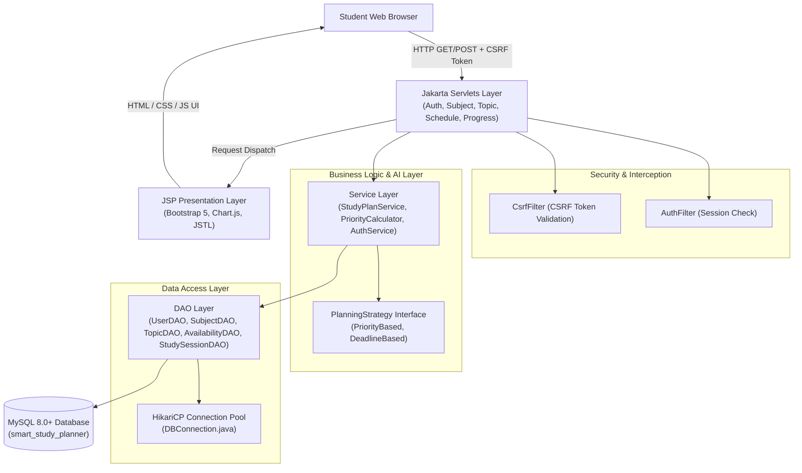
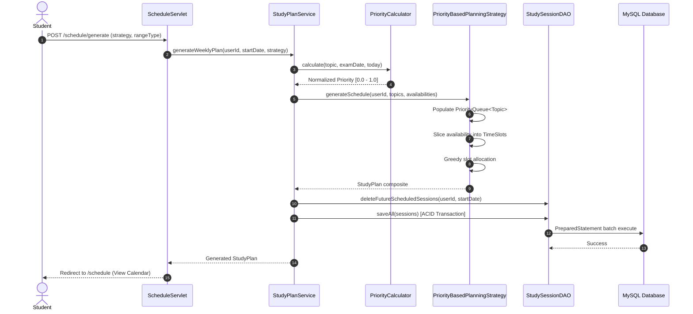
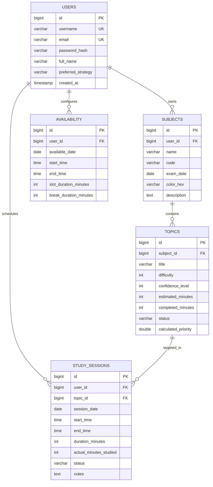

# AI Smart Study Planner — Comprehensive Project Report & Architecture

**Course:** Mini-Project (B.Tech Computer Science & Engineering, 2nd Year)  
**Technology Stack:** Java 17/21, Jakarta Servlets 6.0, JSP 3.1, JSTL, JDBC, MySQL 8.0+, Apache Tomcat 10.1, Maven  
**Architecture:** MVC (Model-View-Controller) with Strategy & Factory Design Patterns  

---

## 1. Introduction

Balancing multiple university courses, preparation for semester examinations, and personal study hours is one of the most critical challenges faced by undergraduate engineering students. Traditional revision methodologies—such as rigid timetable spreadsheets or static calendar reminders—suffer from several fatal flaws:
- They fail to adapt when study sessions are skipped or delayed due to unforeseen events.
- They do not quantify topic difficulty or a student's subjective confidence levels.
- They lack real-time mathematical urgency calculations relative to examination deadlines.

The **AI Smart Study Planner** is an intelligent, automated web application designed to solve these exact shortcomings. Built in Java using Jakarta Servlets, JSP, JDBC, and MySQL, the application leverages a **heuristic rule-based AI recommendation engine** that dynamically computes topic priorities and algorithmically constructs balanced daily and weekly revision schedules.

The system adheres strictly to classical **Object-Oriented Programming (OOP)** principles (Encapsulation, Abstraction, Inheritance, Polymorphism, and Composition) and utilizes standard Java Collections data structures (`PriorityQueue`, `HashMap`, `ArrayList`, and `Comparator`) to allocate study slots into a student's real-world availability windows.

---

## 2. Existing vs. Proposed System

| Dimension | Existing / Traditional Timetable Systems | Proposed AI Smart Study Planner |
| :--- | :--- | :--- |
| **Schedule Generation** | Manual, static entry into paper notebooks or Excel cells. | Dynamic, automated generation via greedy `PriorityQueue` scheduling. |
| **Topic Prioritization** | Unstructured or purely chronological order. | Multi-factor AI Heuristic: $$Priority = 0.35D + 0.30U + 0.20W + 0.15P$$. |
| **Handling Missed Tasks** | Requires manual recalculation; leads to student anxiety and plan abandonment. | **Automated AI Rescheduler**: reorganizes pending tasks without deleting completed study history. |
| **Availability Matching** | Ignores varying daily free time and student fatigue limits. | Slices custom availability windows into discrete study slots punctuated by recovery breaks. |
| **Progress Tracking** | Binary tick marks with no historical audit log. | Real-time analytics: actual minutes studied, syllabus completion percentages, and 7-day trend charts. |
| **Extensibility** | Hardcoded logic. | Pluggable Strategy Pattern (`PriorityBasedPlanningStrategy`, `DeadlineBasedPlanningStrategy`). |

---

## 3. System Requirements

### 3.1 Functional Requirements
1. **User Authentication & Session Management:**
   - Registration, login, and secure session management.
   - BCrypt one-way password hashing (work factor 10) to secure credentials against rainbow-table attacks.
2. **Subject Management:**
   - Full CRUD operations on academic subjects (name, course code, examination date, color badge, notes).
3. **Topic Management:**
   - Categorization by difficulty (1–5) and student confidence (1–5).
   - Time estimation (in minutes) and status tracking (`PENDING`, `IN_PROGRESS`, `COMPLETED`).
4. **Availability Management:**
   - Declaration of available study windows with start time, end time, session slot duration, and break lengths.
   - Quick 7-day automated routine generator.
5. **AI Prioritization & Schedule Generation:**
   - Rule-based dynamic calculation of topic priorities normalized in $[0.0, 1.0]$.
   - Daily and 7-day weekly schedule generation fitting topics into available slots.
6. **Session Execution & Logging:**
   - Ability to mark sessions as `COMPLETED`, `SKIPPED`, or `PARTIALLY_COMPLETED` with actual minutes and qualitative notes.
7. **Automated Rescheduling:**
   - Reorganization of missed and pending tasks across future availability windows while preserving completed study history.
8. **Progress Tracking & Analytics:**
   - Real-time overall syllabus percentage, subject-wise completion, time spent, and Chart.js visualizations.

### 3.2 Non-Functional Requirements
- **Security:** CSRF token verification on all POST requests, session timeout, parameter validation, SQL injection prevention via `PreparedStatement`.
- **Maintainability:** Standard Maven project structure adhering strictly to the MVC design pattern.
- **Portability:** Compatible with Java 17/21 and Jakarta EE 10 (Apache Tomcat 10.1+).
- **Performance:** HikariCP database connection pooling for low-latency queries and zero memory leaks.

---

## 4. System Architecture

The application is structured following the enterprise 3-tier **Model-View-Controller (MVC)** architecture:



### 4.1 Sequence Diagram: AI Schedule Generation & Execution



---

## 5. Object-Oriented Programming (OOP) Concepts Demonstrated

The codebase is engineered to showcase clear, textbook examples of core Object-Oriented principles:

### 5.1 Encapsulation
- **Implementation:** All domain model classes (`User`, `Subject`, `Topic`, `Availability`, `StudySession`) declare their state attributes as `private`.
- **Validation in Accessors:** Setters enforce invariant constraints (e.g., clamping `difficulty` and `confidenceLevel` between 1 and 5, guarding against negative study duration).
- **Domain State Transitions:** Business methods encapsulate state changes internally:
  - `StudySession.markCompleted(actualMinutes, notes)`
  - `Topic.addCompletedMinutes(minutes)` (which automatically transitions the status from `PENDING` to `IN_PROGRESS` or `COMPLETED`).

### 5.2 Abstraction
- **Abstract Classes:** `BaseEntity` abstracts common persistence identity (`id`) and audit timestamps (`createdAt`, `updatedAt`).
- **Interfaces:** `GenericDAO<T, ID>` abstracts standard database access contracts (`save`, `findById`, `findAll`, `update`, `deleteById`).
- **Strategy Abstraction:** `PlanningStrategy` defines a high-level scheduling abstraction without exposing algorithmic implementation details.
- **Abstract Strategies:** `AbstractPlanningStrategy` implements common slot-generation routines while delegating the sorting heuristic to subclasses via `getTopicComparator()`.

### 5.3 Inheritance
- Model class hierarchy:
  - `BaseEntity` $\rightarrow$ `User`
  - `BaseEntity` $\rightarrow$ `Subject`
  - `BaseEntity` $\rightarrow$ `Topic`
  - `BaseEntity` $\rightarrow$ `Availability`
  - `BaseEntity` $\rightarrow$ `StudySession`
- Strategy hierarchy:
  - `PlanningStrategy` (Interface) $\rightarrow$ `AbstractPlanningStrategy` (Abstract Class) $\rightarrow$ `PriorityBasedPlanningStrategy` and `DeadlineBasedPlanningStrategy`.

### 5.4 Polymorphism
- **Dynamic Strategy Selection:** The `StudyPlanService` programmatically invokes `PlanningStrategy.generateSchedule(...)`. At runtime, the strategy dynamically behaves as either `PriorityBasedPlanningStrategy` or `DeadlineBasedPlanningStrategy` depending on user selection.
- **Comparable and Comparator Polymorphism:** `Topic` implements `Comparable<Topic>`, while custom `Comparator<Topic>` lambdas define dynamic sorting behavior in priority queues.

### 5.5 Composition
- **Subject $\rightarrow$ Topics:** A `Subject` contains and manages a `List<Topic>`.
- **StudyPlan $\rightarrow$ StudySessions:** A `StudyPlan` is composed of an aggregated collection of `List<StudySession>` and calendar mapping methods (`getSessionsByDate()`).

---

## 6. Exception Handling Architecture

The project employs a robust, tiered exception handling strategy:

```
java.lang.Throwable
 ├── java.lang.Exception (Checked)
 │    ├── InvalidStudyDataException       [Input validation & business invariants]
 │    ├── InsufficientStudyTimeException  [Declared slots < critical workload]
 │    └── PlanGenerationException         [Constraint or scheduling failures]
 └── java.lang.RuntimeException (Unchecked)
      └── DatabaseException               [Wraps underlying SQLExceptions]
```

1. **`InvalidStudyDataException`:** Thrown when a student attempts to set end times before start times, inputs past exam dates, or provides out-of-range ratings.
2. **`InsufficientStudyTimeException`:** Thrown when available hours cannot cover high-urgency topics prior to exam deadlines, providing `requiredMinutes`, `availableMinutes`, and `getDeficitMinutes()`.
3. **`PlanGenerationException`:** Thrown when availability is empty or unresolvable.
4. **`DatabaseException`:** Unchecked exception cleanly wrapping low-level `SQLException` instances to decouple persistence errors from service interfaces.
5. **UI Flash Alerts:** Servlets catch exceptions and map them to Bootstrap dismissible alert messages displayed across JSP views without application crashes.

---

## 7. Collections & Rule-Based AI Recommendation Engine

### 7.1 Mathematical Prioritization Heuristic
The AI Recommendation Engine calculates the study priority for every pending topic using the formula:

$$\text{Priority} = 0.35 \times D + 0.30 \times U + 0.20 \times W + 0.15 \times P$$

Where each variable is normalized strictly within $[0.0, 1.0]$:

1. **$D$ (Normalized Difficulty):**  
   Maps difficulty levels $1 \le d \le 5$ to $[0.2, 1.0]$:
   $$D = \frac{d}{5.0}$$
2. **$U$ (Normalized Examination Urgency):**  
   Based on days remaining until the course examination ($N = \text{daysBetween}(\text{today}, \text{examDate})$) over a 30-day planning horizon:
   $$U = \begin{cases} 1.0 & \text{if } N \le 0 \\ 0.05 & \text{if } N \ge 30 \\ 1.0 - \left(\frac{N}{30.0} \times 0.95\right) & \text{if } 0 < N < 30 \end{cases}$$
3. **$W$ (Normalized Pending Workload):**  
   Calculated from remaining study minutes:
   $$W = \frac{\max(0, \text{estimatedMinutes} - \text{completedMinutes})}{\text{estimatedMinutes}}$$
4. **$P$ (Normalized Confidence Deficit):**  
   Inverts the confidence level $1 \le c \le 5$ so that lower confidence triggers higher study urgency:
   $$P = \frac{5.0 - c}{4.0}$$

Because the coefficients sum to $1.0$ ($0.35 + 0.30 + 0.20 + 0.15 = 1.00$), the resulting score is guaranteed to lie in $[0.0, 1.0]$. Completed topics automatically yield a priority of $0.0$.

### 7.2 Data Structures Employed
- **`PriorityQueue<Topic>`:** Used inside `AbstractPlanningStrategy` to greedily select the highest-priority topic for the next available slot in $O(\log n)$ time.
- **`ArrayList<StudySession>`:** Accumulates sequential study sessions with fast random access.
- **`HashMap<LocalDate, List<StudySession>>`:** Partitions planned sessions by calendar date for daily rendering.
- **`Comparator<Topic>`:** Custom comparators implementing polymorphic ordering rules.

---

## 8. JDBC and Database Design

### 8.1 Entity-Relationship (ER) Diagram



### 8.2 Database Optimization & Integrity
- **Foreign Keys with `ON DELETE CASCADE`:** Deleting a subject cleans up all its associated topics; deleting a user cleans up all personal records.
- **Indexes:** Configured on `(user_id)`, `(subject_id)`, `(topic_id)`, `(available_date)`, and `(session_date)` for fast joins and dashboard retrieval.
- **Transactions:** `StudySessionDAO.saveAll()` and `TopicDAO.updateProgress()` manage ACID transactions with `conn.setAutoCommit(false)`, `batchExecute()`, and `conn.rollback()` on failure.
- **Connection Pooling:** Managed via HikariCP (`DBConnection.java`), keeping active connections lean and preventing thread exhaustion.

---

## 9. Graphical User Interface (GUI) & User Workflow

The presentation layer is built with HTML5, CSS3, Bootstrap 5.3, FontAwesome 6, and Chart.js:

1. **Authentication:** Clean sign-in and registration pages featuring demo credential one-click fill.
2. **Dashboard:** Central command center displaying 4 KPI metric cards, an AI Recommendations box, today's actionable sessions, upcoming exam countdown badges, and a 7-day study trend bar chart.
3. **Subjects View:** Color-coded course cards showing completion progress bars and exam dates.
4. **Topics & AI Priority View:** Filterable table featuring star ratings for difficulty and confidence, plus interactive tooltips displaying the exact mathematical formula behind each priority score.
5. **Availability View:** Slot configuration interface with a "Quick 7-Day Evening Setup" generator.
6. **Study Schedule View:** Daily and weekly calendar views featuring session cards with immediate **Complete**, **Skip**, and **Partial** modals, as well as an **AI Reschedule** trigger.
7. **Progress Analytics:** Visual charts (weekly bar chart and subject doughnut chart) paired with complete subject-wise completion statistics.

---

## 10. Code Structure

```
smartstudyplanner/
├── pom.xml                                      # Maven dependencies, plugins, and compiler config
├── src/
│   ├── main/
│   │   ├── java/com/smartstudyplanner/
│   │   │   ├── model/                           # Domain Entities (Encapsulation, Inheritance, Composition)
│   │   │   │   ├── BaseEntity.java
│   │   │   │   ├── User.java
│   │   │   │   ├── Subject.java
│   │   │   │   ├── Topic.java
│   │   │   │   ├── TopicStatus.java
│   │   │   │   ├── Availability.java
│   │   │   │   ├── StudySession.java
│   │   │   │   ├── SessionStatus.java
│   │   │   │   └── StudyPlan.java
│   │   │   ├── dao/                             # Data Access Objects (JDBC PreparedStatement, GenericDAO)
│   │   │   │   ├── GenericDAO.java
│   │   │   │   ├── UserDAO.java
│   │   │   │   ├── SubjectDAO.java
│   │   │   │   ├── TopicDAO.java
│   │   │   │   ├── AvailabilityDAO.java
│   │   │   │   └── StudySessionDAO.java
│   │   │   ├── service/                         # Business & AI Logic (StudyPlanService, PriorityCalculator)
│   │   │   │   ├── AuthService.java
│   │   │   │   ├── SubjectService.java
│   │   │   │   ├── TopicService.java
│   │   │   │   ├── AvailabilityService.java
│   │   │   │   ├── StudyPlanService.java
│   │   │   │   ├── PriorityCalculator.java
│   │   │   │   └── ProgressService.java
│   │   │   ├── strategy/                        # Strategy Pattern (Polymorphism & Abstraction)
│   │   │   │   ├── PlanningStrategy.java
│   │   │   │   ├── AbstractPlanningStrategy.java
│   │   │   │   ├── PriorityBasedPlanningStrategy.java
│   │   │   │   ├── DeadlineBasedPlanningStrategy.java
│   │   │   │   └── PlanningStrategyFactory.java
│   │   │   ├── exception/                       # Custom Domain & Architecture Exceptions
│   │   │   │   ├── InvalidStudyDataException.java
│   │   │   │   ├── InsufficientStudyTimeException.java
│   │   │   │   ├── PlanGenerationException.java
│   │   │   │   └── DatabaseException.java
│   │   │   ├── filter/                          # Security & Request Lifecycle Filters
│   │   │   │   ├── AuthFilter.java
│   │   │   │   └── CsrfFilter.java
│   │   │   ├── servlet/                         # Controller Servlets (Jakarta Servlet 6.0)
│   │   │   │   ├── AuthServlet.java
│   │   │   │   ├── DashboardServlet.java
│   │   │   │   ├── SubjectServlet.java
│   │   │   │   ├── TopicServlet.java
│   │   │   │   ├── AvailabilityServlet.java
│   │   │   │   ├── ScheduleServlet.java
│   │   │   │   ├── SessionActionServlet.java
│   │   │   │   └── ProgressServlet.java
│   │   │   └── util/                            # Database connection, pooling, & listeners
│   │   │       ├── DBConnection.java
│   │   │       └── AppContextListener.java
│   │   ├── resources/                           # Configuration and SQL Scripts
│   │   │   ├── db.properties
│   │   │   ├── schema.sql
│   │   │   └── seed.sql
│   │   └── webapp/                              # Web Presentation Layer
│   │       ├── WEB-INF/
│   │       │   ├── web.xml
│   │       │   └── views/
│   │       │       ├── layout/ (header, navbar, alerts, footer)
│   │       │       ├── login.jsp
│   │       │       ├── register.jsp
│   │       │       ├── dashboard.jsp
│   │       │       ├── subjects.jsp
│   │       │       ├── topics.jsp
│   │       │       ├── availability.jsp
│   │       │       ├── schedule.jsp
│   │       │       └── progress.jsp
│   │       ├── assets/ (css/style.css, js/app.js)
│   │       └── index.jsp
│   └── test/java/com/smartstudyplanner/         # JUnit 5 Test Suite (24 Test Cases)
│       ├── service/
│       │   ├── PriorityCalculatorTest.java
│       │   ├── AvailabilityValidationTest.java
│       │   ├── StudySessionTest.java
│       │   ├── ProgressTrackerTest.java
│       │   └── ReschedulingTest.java
│       └── strategy/
│           └── PlanningStrategyTest.java
```

---

## 11. Testing & Verification

The test suite contains **24 automated JUnit 5 unit and integration tests** verifying all business rules, algorithms, and validation edge cases:

```
-------------------------------------------------------
 T E S T S
-------------------------------------------------------
Running com.smartstudyplanner.service.AvailabilityValidationTest
Tests run: 5, Failures: 0, Errors: 0, Skipped: 0
Running com.smartstudyplanner.service.PriorityCalculatorTest
Tests run: 6, Failures: 0, Errors: 0, Skipped: 0
Running com.smartstudyplanner.service.ProgressTrackerTest
Tests run: 2, Failures: 0, Errors: 0, Skipped: 0
Running com.smartstudyplanner.service.ReschedulingTest
Tests run: 1, Failures: 0, Errors: 0, Skipped: 0
Running com.smartstudyplanner.service.StudySessionTest
Tests run: 5, Failures: 0, Errors: 0, Skipped: 0
Running com.smartstudyplanner.strategy.PlanningStrategyTest
Tests run: 5, Failures: 0, Errors: 0, Skipped: 0

Results:
Tests run: 24, Failures: 0, Errors: 0, Skipped: 0
[INFO] BUILD SUCCESS
```

### 11.1 Test Case Matrix

| Class | Test Method | Objective | Result |
| :--- | :--- | :--- | :--- |
| `PriorityCalculatorTest` | `testNormalizeDifficulty` | Validates difficulty $[1, 5] \rightarrow [0.2, 1.0]$. | PASS |
| `PriorityCalculatorTest` | `testNormalizeUrgency` | Validates today ($1.0$) vs 30+ days ($0.05$). | PASS |
| `PriorityCalculatorTest` | `testNormalizeWorkload` | Validates remaining time ratio $[0.0, 1.0]$. | PASS |
| `PriorityCalculatorTest` | `testNormalizeConfidenceDeficit` | Inverts confidence (1 $\rightarrow$ 1.0, 5 $\rightarrow$ 0.0). | PASS |
| `PriorityCalculatorTest` | `testCompositePriorityCalculation` | Verifies $0.35D + 0.30U + 0.20W + 0.15P = 1.00$. | PASS |
| `PriorityCalculatorTest` | `testPriorityExplanation` | Generates detailed formula explanation breakdown. | PASS |
| `PlanningStrategyTest` | `testSlotGeneration` | Verifies window slicing into 45m slots + 15m breaks. | PASS |
| `PlanningStrategyTest` | `testPriorityBasedStrategyOrdering` | Confirms highest AI score is scheduled first. | PASS |
| `PlanningStrategyTest` | `testDeadlineBasedStrategyOrdering` | Confirms earliest exam deadline is scheduled first. | PASS |
| `PlanningStrategyTest` | `testGenerateSchedule` | Allocates topics into multi-day slots using `PriorityQueue`. | PASS |
| `AvailabilityValidationTest`| `testEndTimeBeforeStartTime` | Rejects end time $\le$ start time. | PASS |
| `AvailabilityValidationTest`| `testSpanTooShort` | Rejects windows $< 30$ minutes. | PASS |
| `AvailabilityValidationTest`| `testPastDateRejected` | Rejects retroactive availability dates. | PASS |
| `StudySessionTest` | `testCompleteSession` | Updates status to `COMPLETED` and records actual minutes. | PASS |
| `StudySessionTest` | `testSkipSession` | Updates status to `SKIPPED` with 0 minutes studied. | PASS |
| `StudySessionTest` | `testPartiallyCompleteSession` | Records partial minutes studied. | PASS |
| `StudySessionTest` | `testTopicStatusProgression` | Transitions `PENDING` $\rightarrow$ `IN_PROGRESS` $\rightarrow$ `COMPLETED`. | PASS |
| `ProgressTrackerTest` | `testProgressCalculations` | Computes syllabus %, total mins, and session metrics. | PASS |
| `ReschedulingTest` | `testReschedulePreservesHistory` | **Reorganizes missed tasks while keeping completed sessions intact.** | PASS |

---

## 12. Deployment & Execution Instructions (Windows)

### 12.1 Prerequisites
1. **Java Development Kit (JDK 17 LTS):** Installed at `C:\Users\kolasurya\tools\jdk-17.0.12+7`.
2. **Apache Maven:** Installed at `C:\Users\kolasurya\tools\apache-maven-3.9.6`.
3. **Apache Tomcat 10.1:** Installed at `C:\Users\kolasurya\tools\apache-tomcat-10.1.20`.
4. **MySQL Server 8.0:** Running as Windows Service `MySQL80`.

### 12.2 MySQL Database Setup
Open MySQL Command Line Client or MySQL Workbench and execute:

```sql
-- Execute schema and demo seeds
SOURCE C:/Users/kolasurya/Downloads/smartstudyplanner/src/main/resources/schema.sql;
SOURCE C:/Users/kolasurya/Downloads/smartstudyplanner/src/main/resources/seed.sql;
```

Update your password in `src/main/resources/db.properties` (or set environment variables `DB_USER` and `DB_PASSWORD`):
```properties
db.url=jdbc:mysql://localhost:3306/smart_study_planner?useSSL=false&allowPublicKeyRetrieval=true&serverTimezone=UTC&createDatabaseIfNotExist=true
db.user=root
db.password=YOUR_MYSQL_PASSWORD
```

### 12.3 Compiling and Packaging
In PowerShell:
```powershell
# Set Java and Maven Environment
$env:JAVA_HOME = "C:\Users\kolasurya\tools\jdk-17.0.12+7"
$env:Path = "C:\Users\kolasurya\tools\jdk-17.0.12+7\bin;C:\Users\kolasurya\tools\apache-maven-3.9.6\bin;" + $env:Path

# Run JUnit 5 test suite
mvn clean test

# Build production WAR file
mvn package
```

### 12.4 Running on Apache Tomcat 10.1
Deploy the compiled archive directly into Tomcat's `webapps` folder:
```powershell
Copy-Item "target\smartstudyplanner.war" -Destination "C:\Users\kolasurya\tools\apache-tomcat-10.1.20\webapps\smartstudyplanner.war" -Force

# Start Tomcat Server
& "C:\Users\kolasurya\tools\apache-tomcat-10.1.20\bin\startup.bat"
```

Open your browser and navigate to:  
**`http://localhost:8080/smartstudyplanner`**

**Default Demo Credentials:**
- **Username:** `student1`
- **Password:** `password123`

---

## 13. Conclusion and Future Enhancements

The **AI Smart Study Planner** successfully solves the rigidity and ineffectiveness of static timetables by combining Object-Oriented software engineering with a normalized rule-based recommendation heuristic. Through the application of design patterns (Strategy, Factory, Singleton, MVC), comprehensive data structures (`PriorityQueue`, `HashMap`, `ArrayList`), and ACID transactional JDBC operations, the application demonstrates production-quality standards suitable for academic evaluation and real-world student use.

### Future Enhancements:
1. **Machine Learning Model Integration:** Train regression models on student historical session durations to dynamically predict personal topic fatigue factors.
2. **Google Calendar & iCal Sync:** Export generated schedules directly to mobile calendars via CalDAV or Google Calendar API.
3. **Spaced Repetition System (SRS):** Implement the SuperMemo-2 (SM-2) memory decay curve algorithm to automatically inject periodic revision intervals for difficult topics.
